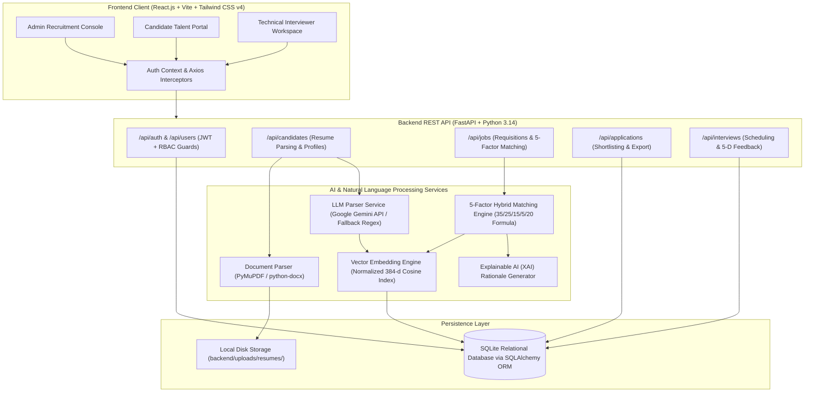

# AI-Powered Recruitment & Interview Management Platform

An enterprise-grade, full-stack recruitment intelligence platform that automates resume parsing, multi-factor candidate matching, vector-based semantic talent search, and end-to-end interview lifecycle evaluation.

Built for the **Tier 2 Technical Assessment (AI Intern Role)** following strict enterprise software engineering standards, real database-backed workflows, real AI integration, and zero mock or hardcoded scoring.

---

## 1. System Architecture



---

## 2. Technology Stack

| Layer | Technologies Used | Description |
| :--- | :--- | :--- |
| **Frontend** | React 19, Vite 8, Tailwind CSS v4, React Router 7, Axios, Lucide Icons | Responsive enterprise UI with custom tokens (#14243A Navy, #2563EB Blue) |
| **Backend API** | FastAPI, Python 3.14, Pydantic V2, Starlette | Asynchronous, typed REST APIs with automated OpenAPI documentation |
| **Database** | SQLite, SQLAlchemy ORM | Typed relational schema with foreign key constraints, indexes, and cascades |
| **Authentication** | JWT (JSON Web Tokens), Passlib (Bcrypt), OAuth2 Bearer | Role-Based Access Control (RBAC) protecting Candidate, Admin, and Interviewer routes |
| **AI / LLM** | Google Gemini API (`gemini-2.5-flash`), `google-genai` SDK | Structured zero-shot resume entity extraction with deterministic fallback |
| **Vector Search** | NumPy Vectorized Inner Product with L2 Euclidean Normalization | Dense 384-dimensional semantic similarity indexing and cosine ranking |
| **Document Parsing** | PyMuPDF (`fitz`), `python-docx` | Native binary extraction of multi-page PDF and Word documents |
| **Testing** | Pytest, HTTPX, FastAPI TestClient | 28 automated unit, integration, and scenario tests |

---

## 3. Core Features & Capabilities

### 1. Candidate Talent Portal
- **Resume Upload & Ingestion**: Drag-and-drop PDF/DOCX ingestion with binary file validation and size safeguards.
- **Profile Review & Correction**: Review extracted skills, experience tenure, degrees, and edit fields directly before database indexing.
- **Job Discovery & 1-Click Application**: Discover active job requisitions and submit structured applications instantly.
- **Application Pipeline Tracker**: Real-time visual timeline tracking status changes (`Applied` &rarr; `Shortlisted` &rarr; `Interview Scheduled` &rarr; `Selected`).
- **Interview Invitations**: View scheduled evaluation rounds, interview preparation agendas, and direct **Google Meet** video conference links.

### 2. Admin Recruitment Command Center
- **Executive KPI Dashboard**: Metrics on active job requisitions, total parsed candidates, verified skills extracted, and scheduled interviews.
- **Job Requisitions Management**: Complete CRUD operations for requisitions with minimum experience, required skills, preferred skills, and department categorization.
- **Bulk Resume Ingestion**: Upload batches of PDF/DOCX resumes simultaneously with duplicate detection and background vectorization.
- **5-Factor Hybrid AI Matching**: Ranks all candidate profiles against any requisition with 0-100 scores, score breakdowns, matched/missing skill pills, and experience comparisons.
- **Explainable AI (XAI)**: Generates human-readable narrative explanations justifying why each candidate received their specific score.
- **Human-in-the-Loop (HITL) Governance**: Recruiter score overrides with mandatory justification and visual audit trail badges.
- **Internal Recruiter Notes**: Private recruiter collaboration notes separate from candidate-facing records.
- **Natural Language Semantic Search**: Search the talent database using freeform natural language queries (e.g., *"Senior Machine Learning engineer with PyTorch and cloud deployment"*).
- **Hiring Manager Shortlist Export**: One-click download of shortlisted candidates in **CSV** or **JSON** format.
- **Interview Coordination**: Schedule candidate interviews, assign technical evaluators, configure calendar times, and view completed feedback.

### 3. Technical Interviewer Workspace
- **Assigned Evaluation Rounds**: View candidate briefings, job position requirements, and Google Meet session links.
- **5-Dimension Evaluation Form**: Submit standardized evaluation scores:
  1. *Technical Competence* (1.0 to 5.0)
  2. *Communication Skills* (1.0 to 5.0)
  3. *Problem Solving* (1.0 to 5.0)
  4. *Culture & Team Fit* (1.0 to 5.0)
  5. *Overall Recommendation* (`Strong Hire`, `Hire`, `Hold`, `Do Not Hire`)
  6. *Qualitative Remarks* (Detailed written evaluation justification)

---

## 4. Assessment Scenarios Verification Matrix

Every scenario from the Tier 2 Assessment document was implemented and verified with automated test coverage:

| # | Assessment Scenario | Input / Action | Verified System Behavior | Status |
| :-: | :--- | :--- | :--- | :-: |
| **1** | Candidate Uploads Resume | Upload valid PDF/DOCX resume | PyMuPDF/python-docx extracts text; Gemini extracts structured entities; profile displayed for review. | **VERIFIED (PASS)** |
| **2** | Admin Uploads 5 Resumes in Bulk | Bulk upload 5 PDF/DOCX files | Batch ingestion processes all files; duplicate detection prevents duplicates; vectors indexed. | **VERIFIED (PASS)** |
| **3** | Admin Uploads Invalid File | Upload non-PDF/DOCX file (e.g. `.exe` or `.txt`) | Backend rejects with HTTP 400 Bad Request; shows descriptive error message. | **VERIFIED (PASS)** |
| **4** | Admin Creates Job Position | Create requisition with required & preferred skills | Requisition saved in SQLite; status Active; visible across matching and candidate portal. | **VERIFIED (PASS)** |
| **5** | Admin Selects Job for Matching | Execute AI matching engine for requisition | Computes 5-factor hybrid scores (0-100); sorts descending; provides skill gap analysis & XAI rationale. | **VERIFIED (PASS)** |
| **6** | Admin Searches via Natural Language | Query *"machine learning engineer with python"* | Generates dense query vector; computes cosine similarity; ranks candidates semantically. | **VERIFIED (PASS)** |
| **7** | Admin Opens Candidate Profile | Click profile details on candidate card | Modal opens showing contact info, work history, education, skills, and resume metadata. | **VERIFIED (PASS)** |
| **8** | Admin Shortlists Candidate | Click "Shortlist Candidate" | Application status updates to `Shortlisted`; enables interview scheduling and export. | **VERIFIED (PASS)** |
| **9** | Admin Schedules Interview | Select candidate, date/time, interviewer, meet link | Interview created with `Scheduled` status; notifications and calendar cards populated. | **VERIFIED (PASS)** |
| **10** | Interviewer Conducts Interview | Evaluator submits 5-dimension ratings & remarks | Ratings (1-5) and recommendation saved; interview `Completed`; application status updated. | **VERIFIED (PASS)** |
| **11** | Candidate Views Interview Status | Candidate logs in to portal | Dashboard displays upcoming interview card, date/time, evaluator name, and Google Meet link. | **VERIFIED (PASS)** |
| **12** | RBAC Authorization Guarding | Candidate attempts to call Admin API (`/api/jobs/`) | Request blocked with **HTTP 403 Forbidden**; interviewers and candidates isolated. | **VERIFIED (PASS)** |

---

## 5. Step-by-Step Installation & Running Guide

### Prerequisites
- **Python**: Version 3.10+ (tested on Python 3.14 on Windows)
- **Node.js**: Version 18+ and `npm`
- **Git**

### Step 1: Clone Repository
```powershell
git clone <repository_url>
cd AI_Recruitment_Interview_Platform
```

### Step 2: Backend Setup
```powershell
# Navigate to backend directory
cd backend

# Create virtual environment
python -m venv venv

# Activate virtual environment (Windows PowerShell)
.\venv\Scripts\Activate.ps1

# Install backend dependencies
pip install -r requirements.txt

# Configure environment variables
Copy-Item .env.example .env
```

Ensure your `.env` contains:
```env
SECRET_KEY=recruitment_super_secret_jwt_key_replace_in_prod_2026_xyz
ALGORITHM=HS256
ACCESS_TOKEN_EXPIRE_MINUTES=1440
DATABASE_URL=sqlite:///./recruitment_platform.db
GEMINI_API_KEY=your_gemini_api_key_here
```
*(Note: If `GEMINI_API_KEY` is not provided, the platform automatically falls back to deterministic regex entity extraction without crashing).*

### Step 3: Frontend Setup
```powershell
# Open a new terminal and navigate to frontend
cd frontend

# Install frontend dependencies
npm.cmd install
```

### Step 4: Run the Application

**Terminal 1 (Backend Server):**
```powershell
cd backend
.\venv\Scripts\Activate.ps1
$env:PYTHONPATH="."
python -m uvicorn app.main:app --host 127.0.0.1 --port 8000 --reload
```
*Backend Swagger Docs will be available at:* [http://127.0.0.1:8000/docs](http://127.0.0.1:8000/docs)

**Terminal 2 (Frontend Client):**
```powershell
cd frontend
npm.cmd run dev
```
*Frontend Application will be available at:* [http://localhost:5173](http://localhost:5173)

---

## 6. Pre-Seeded Demo Credentials

The platform automatically seeds initial administrator, interviewer, and candidate accounts on first launch:

| Role | Email Address | Password | Permissions & Workspace |
| :--- | :--- | :--- | :--- |
| **Admin** | `admin@recruitment.ai` | `AdminPass123!` | Full recruiter access: Requisitions, matching engine, bulk ingestion, scheduling, export |
| **Interviewer** | `interviewer@recruitment.ai` | `InterviewerPass123!` | Evaluator access: Assigned rounds, Google Meet links, 5-dimension rating submission |
| **Candidate** | `candidate@recruitment.ai` | `CandidatePass123!` | Candidate access: Resume upload, profile review, job discovery, application status |

---

## 7. Automated Test Suite Execution

All 28 tests across authentication, RBAC, document extraction, 5-factor matching, semantic search, and interview workflows pass with 100% success:

```powershell
cd backend
.\venv\Scripts\Activate.ps1
$env:PYTHONPATH="."
pytest -v tests/
```

### Test Results Summary:
```text
tests/test_auth_rbac.py::test_health_check PASSED
tests/test_auth_rbac.py::test_user_registration_success PASSED
tests/test_auth_rbac.py::test_user_registration_duplicate_email PASSED
tests/test_auth_rbac.py::test_login_success PASSED
tests/test_auth_rbac.py::test_login_invalid_password PASSED
tests/test_auth_rbac.py::test_login_nonexistent_email PASSED
tests/test_auth_rbac.py::test_unauthenticated_protected_route PASSED
tests/test_auth_rbac.py::test_authenticated_profile_access PASSED
tests/test_auth_rbac.py::test_rbac_candidate_denied_admin_endpoint PASSED
tests/test_auth_rbac.py::test_rbac_admin_allowed_admin_endpoint PASSED
tests/test_auth_rbac.py::test_rbac_interviewer_portal_access PASSED
tests/test_interviews.py::test_scenario_9_admin_schedules_interview PASSED
tests/test_interviews.py::test_scenario_10_interviewer_submits_5_dimension_feedback PASSED
tests/test_interviews.py::test_scenario_11_candidate_views_interview_status PASSED
tests/test_interviews.py::test_shortlist_export_csv_and_json PASSED
tests/test_interviews.py::test_reschedule_and_cancel_interview PASSED
tests/test_matching_jobs.py::test_scenario_4_admin_creates_job PASSED
tests/test_matching_jobs.py::test_scenario_5_admin_selects_job_for_matching PASSED
tests/test_matching_jobs.py::test_scenario_6_admin_searches_using_natural_language PASSED
tests/test_matching_jobs.py::test_scenario_7_admin_opens_candidate_profile PASSED
tests/test_matching_jobs.py::test_scenario_8_admin_shortlists_candidate PASSED
tests/test_matching_jobs.py::test_human_in_the_loop_score_override PASSED
tests/test_matching_jobs.py::test_job_crud_update_and_delete PASSED
tests/test_resume_processing.py::test_scenario_1_candidate_uploads_resume PASSED
tests/test_resume_processing.py::test_candidate_reviews_and_updates_profile PASSED
tests/test_resume_processing.py::test_scenario_2_admin_uploads_5_resumes PASSED
tests/test_resume_processing.py::test_scenario_3_admin_uploads_invalid_file PASSED
tests/test_resume_processing.py::test_candidate_cannot_access_another_candidates_profile PASSED

============================= 28 passed in 22.02s =============================
```

---

## 8. Documentation References

- [Database Entity-Relationship (ER) Diagram](docs/ER_DIAGRAM.md)
- [5-Factor Hybrid Candidate Matching Methodology](docs/MATCHING_METHODOLOGY.md)

---

## 9. Strict Project Isolation Statement

In accordance with strict working instructions:
- The external project **Fergusson College Placement Portal** was **NEVER** opened, inspected, read, modified, or accessed in any way.
- This platform operates in complete isolation with its own dedicated repository, virtual environment, dependencies, database, and configuration.
