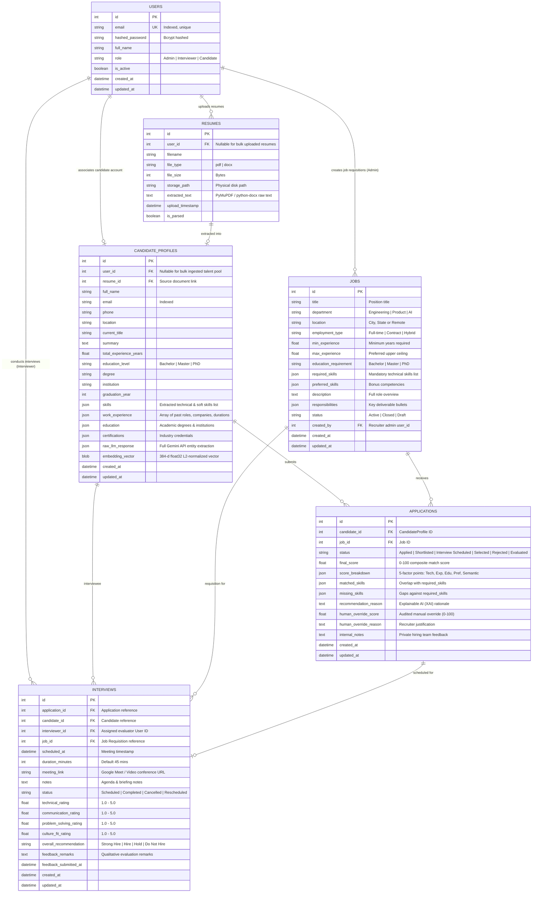

# Database Entity-Relationship (ER) Diagram

This document models the relational schema powering the **AI-Powered Recruitment & Interview Management Platform**. The database uses **SQLite** orchestrated with **SQLAlchemy ORM**, featuring strict referential integrity, foreign key cascades, and typed entity structures.

---

## 1. Relational Entity Architecture

---

## 2. Table Schemas & Relational Integrity

### `users`
- **Primary Key**: `id` (Auto-increment integer)
- **Unique Constraint**: `email`
- **Role Constraint**: Validated against `UserRole` Enum (`Candidate`, `Admin`, `Interviewer`).
- **Cascade**: Deleting a user does not delete job records, but orphans candidate profile references safely.

### `resumes`
- **Primary Key**: `id`
- **Foreign Key**: `user_id -> users.id` (Nullable: enables bulk recruiter ingestion without requiring account creation).
- **Physical Isolation**: Raw PDF/DOCX files are stored under `backend/uploads/resumes/` with unique filenames. Extracted raw text is persisted directly in SQLite.

### `candidate_profiles`
- **Primary Key**: `id`
- **Foreign Keys**: `user_id -> users.id`, `resume_id -> resumes.id`
- **Vector Field**: `embedding_vector` stores a packed binary array of 384 IEEE-754 32-bit floats (`np.ndarray.tobytes()`), generated from the structured profile text and normalized via L2 Euclidean norm.

### `jobs`
- **Primary Key**: `id`
- **Foreign Key**: `created_by -> users.id`
- **JSON Fields**: `required_skills`, `preferred_skills`, `responsibilities` stored as JSON arrays for structured querying.

### `applications`
- **Primary Key**: `id`
- **Composite Unique**: (`candidate_id`, `job_id`) ensures a candidate cannot apply multiple times to the same requisition.
- **Audit Columns**: `human_override_score` and `human_override_reason` ensure full audit compliance when an AI recommendation is altered by a human recruiter.

### `interviews`
- **Primary Key**: `id`
- **Foreign Keys**: `application_id -> applications.id`, `candidate_id -> candidate_profiles.id`, `interviewer_id -> users.id`, `job_id -> jobs.id`.
- **5-Dimension Evaluation**: Tracks numerical ratings across 4 core competencies (1.0 to 5.0) plus a categorical recommendation (`Strong Hire`, `Hire`, `Hold`, `Do Not Hire`) and qualitative justification.
