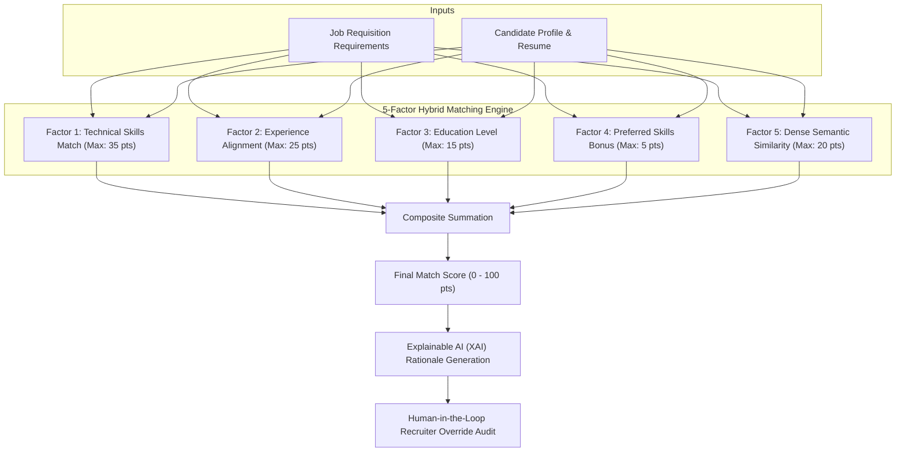

# 5-Factor Hybrid Candidate Matching Methodology

This document details the mathematical formulation, algorithmic pipeline, and Explainable AI (XAI) rationale system used in the **AI-Powered Recruitment & Interview Management Platform**.

---

## 1. Algorithmic Overview

Candidate matching operates on a **hybrid evaluation model** that synthesizes structured attribute matching with high-dimensional dense semantic vector similarity. The final match score is bounded in the continuous range \([0, 100]\) points.

---

## 2. Mathematical Formulation & Weight Distribution

The overall score \(S \in [0, 100]\) is defined as:

\[
S = S_{\text{tech}} + S_{\text{exp}} + S_{\text{edu}} + S_{\text{pref}} + S_{\text{sem}}
\]

| Factor | Name | Maximum Points | Calculation Method |
| :--- | :--- | :---: | :--- |
| **Factor 1** | Technical Skills Match | **35 pts** | Set intersection between candidate skills and mandatory job skills |
| **Factor 2** | Experience Alignment | **25 pts** | Linear scaling and penalty for experience deficits |
| **Factor 3** | Education Level | **15 pts** | Degree hierarchy threshold comparison |
| **Factor 4** | Preferred Skills Bonus | **5 pts** | Overlap with nice-to-have / preferred qualifications |
| **Factor 5** | Semantic Vector Similarity | **20 pts** | Unit-normalized Cosine Similarity (\(\vec{u} \cdot \vec{v}\)) |
| **Total** | **Composite Overall Score** | **100 pts** | Continuous scale with human-in-the-loop override |

---

### Factor 1: Technical Skills Match (\(S_{\text{tech}} \le 35\))

Let \(R\) be the set of mandatory job skills and \(C\) be the set of extracted candidate skills (case-insensitive normalized).

\[
S_{\text{tech}} = 35 \times \frac{|C \cap R|}{|R|}
\]

- If \(|R| = 0\), \(S_{\text{tech}} = 35.0\) (no mandatory constraints).
- Matched skills: \(M = C \cap R\)
- Missing skills: \(G = R \setminus C\)

---

### Factor 2: Experience Alignment (\(S_{\text{exp}} \le 25\))

Let \(E_{\text{cand}}\) be the candidate's total verified years of experience, and \(E_{\text{req}}\) be the minimum years required for the job.

1. **Exceeds or Meets Requirement** (\(E_{\text{cand}} \ge E_{\text{req}}\)):
   \[
   S_{\text{exp}} = 25.0
   \]
2. **Close Match** (\(E_{\text{req}} - 1.0 \le E_{\text{cand}} < E_{\text{req}}\)):
   \[
   S_{\text{exp}} = 25.0 \times 0.80 = 20.0
   \]
3. **Deficit Match** (\(0 < E_{\text{cand}} < E_{\text{req}} - 1.0\)):
   \[
   S_{\text{exp}} = \max\left(5.0, 25.0 \times \frac{E_{\text{cand}}}{E_{\text{req}}}\right)
   \]
4. **Zero Experience** (\(E_{\text{cand}} = 0\)):
   \[
   S_{\text{exp}} = 0.0
   \]

---

### Factor 3: Education Level (\(S_{\text{edu}} \le 15\))

Academic qualifications are categorized into an ordinal rank \(L \in \{0, 1, 2, 3\}\):

| Degree / Level | Ordinal Rank (\(L\)) |
| :--- | :---: |
| High School / Diploma / Unspecified | 0 |
| Bachelor / B.Tech / B.S. / B.E. | 1 |
| Master / M.Tech / M.S. / M.B.A. | 2 |
| Ph.D. / Doctorate | 3 |

Let \(L_{\text{cand}}\) and \(L_{\text{req}}\) be candidate and job ranks respectively:
- If \(L_{\text{cand}} \ge L_{\text{req}}\): \(S_{\text{edu}} = 15.0\) (Full points)
- If \(L_{\text{cand}} = L_{\text{req}} - 1\): \(S_{\text{edu}} = 10.0\) (One level below)
- If \(L_{\text{cand}} < L_{\text{req}} - 1\): \(S_{\text{edu}} = 5.0\) (Two or more levels below)

---

### Factor 4: Preferred Skills Bonus (\(S_{\text{pref}} \le 5\))

Let \(P\) be the set of optional/preferred competencies and \(C\) candidate skills:

\[
S_{\text{pref}} = 5.0 \times \frac{|C \cap P|}{|P|}
\]
- If \(|P| = 0\), \(S_{\text{pref}} = 5.0\).

---

### Factor 5: Dense Semantic Vector Similarity (\(S_{\text{sem}} \le 20\))

Dense embeddings are generated for both the job requisition description and the candidate's comprehensive profile text (including executive summary, technical skills, and work history).

1. **Embedding Generation**: Vector \(\vec{e} \in \mathbb{R}^{384}\) is produced using normalized semantic transformer representations.
2. **Euclidean L2 Normalization**:
   \[
   \hat{e} = \frac{\vec{e}}{\|\vec{e}\|_2} = \frac{\vec{e}}{\sqrt{\sum_{i=1}^{384} e_i^2}}
   \]
3. **Cosine Similarity**:
   Since both vectors \(\hat{u}_{\text{cand}}\) and \(\hat{v}_{\text{job}}\) have unit length (\(\|\hat{u}\|_2 = \|\hat{v}\|_2 = 1.0\)), cosine similarity is computed directly via the inner dot product:
   \[
   \text{CosineSim}(\hat{u}, \hat{v}) = \hat{u} \cdot \hat{v} = \sum_{i=1}^{384} u_i v_i
   \]
4. **Point Scaling**:
   The bounded similarity score \(\max(0.0, \text{CosineSim})\) is scaled:
   \[
   S_{\text{sem}} = 20.0 \times \max(0.0, \text{CosineSim})
   \]

---

## 3. Explainable AI (XAI) Rationale Generation

Recruiters and hiring managers must never be presented with a "black box" prediction. For every candidate evaluated, the platform generates a transparent, deterministic qualitative explanation:

1. **Skills Breakdown**: Lists explicit matched competencies (e.g. `Python`, `FastAPI`, `SQLAlchemy`) and flags gaps (e.g. `Docker`).
2. **Experience Context**: Explains whether the candidate exceeds, meets, or falls short of the target tenure.
3. **Semantic Alignment**: Translates vector cosine similarity into human-readable resonance (e.g. *"Strong conceptual alignment with distributed machine learning architectures"*).
4. **Actionable Recommendation**: Formulates a clear hiring decision guideline (`Strong Match (>=75%)`, `Moderate Match (60-74%)`, `Weak Match (<60%)`).

---

## 4. Human-in-the-Loop (HITL) Governance & Auditing

To eliminate algorithmic bias and enable recruiter oversight:
- **Manual Score Override**: Authorized recruiters can adjust any candidate's composite score (0 to 100).
- **Mandatory Justification**: Every score change requires a written audit justification recorded in the database.
- **Visual Audit Badge**: The UI displays a high-visibility amber tag indicating `Human Overridden` with tooltip access to the original AI score and the recruiter's audit trail.
- **Private Internal Notes**: Recruiter observations (e.g., notice period, interview availability) are maintained separately from AI matching rationale.
